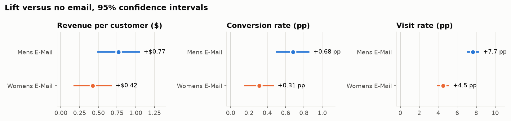
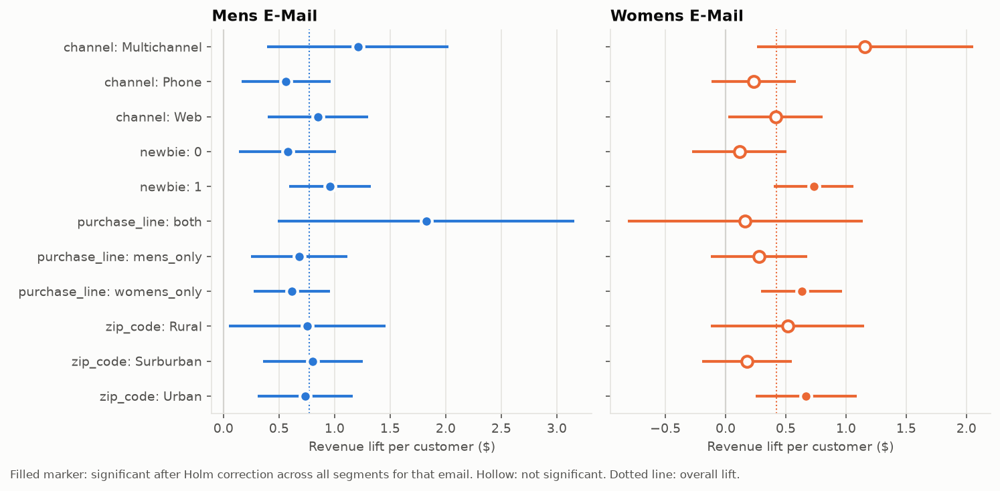
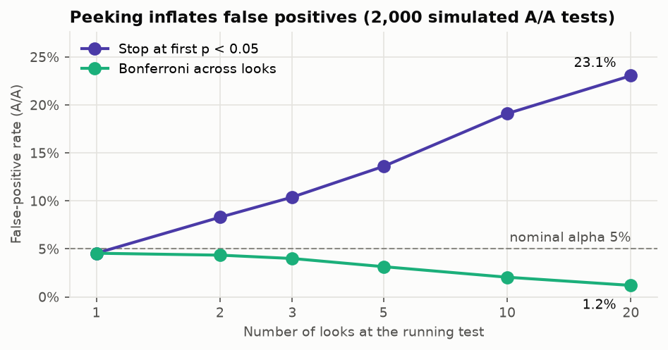
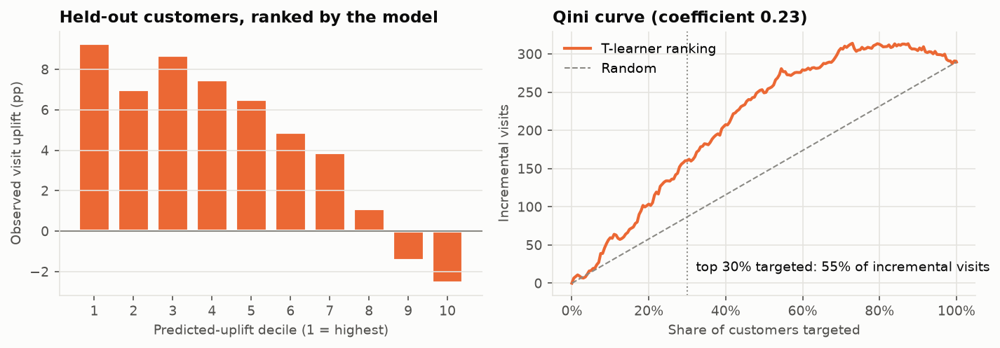

# Experiment Report

Generated by `campaign-experiment run` from `results.json`. The plan this follows is `docs/TEST_PLAN.md`; the one-page summary is `DECISION_MEMO.md`.

## 1. Data

64,000 customers, arms: No E-Mail, Mens E-Mail, Womens E-Mail. 6,562 rows are exact duplicates of another row; they are kept, because the file has no customer id and identical attributes do not make two customers the same person.

| Arm | Customers | Visit rate | Conversion rate | Revenue | Revenue / customer |
|---|---|---|---|---|---|
| No E-Mail | 21,306 | 10.62% | 0.57% | $13,908.33 | $0.65 |
| Mens E-Mail | 21,307 | 18.28% | 1.25% | $30,311.69 | $1.42 |
| Womens E-Mail | 21,387 | 15.14% | 0.88% | $23,038.11 | $1.08 |

## 2. Validity checks

**Sample ratio:** chi-square 0.203, p 0.9037 (fails below 0.001): **pass**.

**Covariate balance:** 22 covariate comparisons, largest |SMD| 0.0137: **all balanced**. The five largest:

| Treatment | Covariate | Control mean | Treatment mean | SMD |
|---|---|---|---|---|
| Mens E-Mail | zip_code_Rural | 0.147 | 0.152 | +0.0137 |
| Mens E-Mail | zip_code_Surburban | 0.452 | 0.446 | -0.0117 |
| Mens E-Mail | channel_Web | 0.440 | 0.445 | +0.0110 |
| Womens E-Mail | mens | 0.553 | 0.549 | -0.0086 |
| Womens E-Mail | channel_Phone | 0.438 | 0.442 | +0.0086 |

## 3. Primary metric: revenue per customer

| Arm | Control | Treatment | Lift | Welch 95% CI | Bootstrap 95% CI | p | Holm p |
|---|---|---|---|---|---|---|---|
| Mens E-Mail | $0.65 | $1.42 | +$0.77 | +$0.49 to +$1.05 | +$0.50 to +$1.06 | < 0.0001 | < 0.0001 |
| Womens E-Mail | $0.65 | $1.08 | +$0.42 | +$0.17 to +$0.68 | +$0.17 to +$0.68 | 0.0011 | 0.0011 |

The Welch and bootstrap intervals agree to within a few cents, so the normal approximation is adequate at this sample size despite the heavy right tail.

## 4. Robustness: capped spend

**Pre-registered check** (cap at the 99th percentile of positive spend = $499.00): **non-binding.** The source file is top-coded: the largest purchase is $499.00 and 12 of 578 purchases sit exactly there, so the planned cap equals the maximum and changes nothing. The check passes trivially and carries no information.

**Post-hoc check, not pre-registered** (cap at the 95th percentile = $362.20), added after the top-coding was found and excluded from the decision:

| Arm | Lift (capped) | 95% CI | Holm p |
|---|---|---|---|
| Mens E-Mail | +$0.74 | +$0.47 to +$1.00 | < 0.0001 |
| Womens E-Mail | +$0.41 | +$0.18 to +$0.65 | 0.0007 |

## 5. Secondary metrics

| Metric | Arm | Control | Treatment | Lift | 95% CI | Holm p |
|---|---|---|---|---|---|---|
| conversion | Mens E-Mail | 0.57% | 1.25% | +0.68 pp | +0.50 pp to +0.86 pp | < 0.0001 |
| conversion | Womens E-Mail | 0.57% | 0.88% | +0.31 pp | +0.15 pp to +0.47 pp | 0.0002 |
| visit | Mens E-Mail | 10.62% | 18.28% | +7.66 pp | +7.00 pp to +8.32 pp | < 0.0001 |
| visit | Womens E-Mail | 10.62% | 15.14% | +4.52 pp | +3.89 pp to +5.16 pp | < 0.0001 |

## 6. Head to head

Womens E-Mail minus Mens E-Mail: -$0.35 per customer (95% CI -$0.66 to -$0.03, p 0.0305).

## 7. Variance reduction (CUPED and regression adjustment)

| Arm | Unadjusted SE | CUPED SE | CUPED variance removed | corr(spend, history) | Regression SE | Regression lift |
|---|---|---|---|---|---|---|
| Mens E-Mail | $0.1452 | $0.1452 | 0.044% | 0.0209 | $0.1451 | +$0.77 |
| Womens E-Mail | $0.1303 | $0.1303 | 0.038% | 0.0195 | $0.1302 | +$0.42 |

CUPED removes a share of variance equal to the squared correlation between the outcome and the covariate. Last year's spend barely predicts spend in a two-week window (most customers spend nothing in both arms of the comparison), so the reduction is negligible here. The regression adjustment with every pre-period covariate does no better. For future tests on this population, variance reduction would need a covariate measured over a comparable short window, such as spend in the two weeks before the send.

## 8. Power at the observed baseline

At alpha 0.025 per comparison and 80% power, with the realised arm sizes and the observed control baseline, the test could detect:

| Metric | Minimum detectable effect |
|---|---|
| Revenue per customer | $0.35 |
| Conversion rate | +0.23 pp |
| Visit rate | +0.92 pp |

Power to detect the observed revenue effect: Mens E-Mail > 99.9%, Womens E-Mail 93.9%. (Observed-effect power is descriptive only; it is a function of the p-value and adds no evidence.)

## 9. Segment effects (exploratory, Holm-corrected per email)

**Mens E-Mail**

| Segment | Level | n (treatment) | Lift | 95% CI | Holm p | Significant |
|---|---|---|---|---|---|---|
| channel | Multichannel | 2,577 | +$1.21 | +$0.39 to +$2.03 | 0.0189 | yes |
| channel | Phone | 9,240 | +$0.56 | +$0.16 to +$0.97 | 0.0243 | yes |
| channel | Web | 9,490 | +$0.85 | +$0.40 to +$1.30 | 0.0024 | yes |
| newbie | 0 | 10,621 | +$0.58 | +$0.14 to +$1.01 | 0.0243 | yes |
| newbie | 1 | 10,686 | +$0.96 | +$0.59 to +$1.33 | < 0.0001 | yes |
| purchase_line | both | 2,181 | +$1.82 | +$0.49 to +$3.16 | 0.0243 | yes |
| purchase_line | mens_only | 9,558 | +$0.68 | +$0.25 to +$1.12 | 0.0128 | yes |
| purchase_line | womens_only | 9,568 | +$0.62 | +$0.27 to +$0.96 | 0.0041 | yes |
| zip_code | Rural | 3,243 | +$0.76 | +$0.05 to +$1.46 | 0.0356 | yes |
| zip_code | Surburban | 9,501 | +$0.80 | +$0.35 to +$1.25 | 0.0041 | yes |
| zip_code | Urban | 8,563 | +$0.74 | +$0.31 to +$1.16 | 0.0049 | yes |

**Womens E-Mail**

| Segment | Level | n (treatment) | Lift | 95% CI | Holm p | Significant |
|---|---|---|---|---|---|---|
| channel | Multichannel | 2,579 | +$1.16 | +$0.26 to +$2.06 | 0.0930 | no |
| channel | Phone | 9,454 | +$0.23 | -$0.12 to +$0.58 | 0.8733 | no |
| channel | Web | 9,354 | +$0.42 | +$0.02 to +$0.81 | 0.2610 | no |
| newbie | 0 | 10,624 | +$0.11 | -$0.28 to +$0.50 | 1.0000 | no |
| newbie | 1 | 10,763 | +$0.73 | +$0.40 to +$1.06 | 0.0002 | yes |
| purchase_line | both | 2,118 | +$0.16 | -$0.81 to +$1.14 | 1.0000 | no |
| purchase_line | mens_only | 9,622 | +$0.28 | -$0.12 to +$0.68 | 0.8733 | no |
| purchase_line | womens_only | 9,647 | +$0.63 | +$0.30 to +$0.97 | 0.0023 | yes |
| zip_code | Rural | 3,181 | +$0.51 | -$0.12 to +$1.15 | 0.6705 | no |
| zip_code | Surburban | 9,650 | +$0.18 | -$0.19 to +$0.55 | 1.0000 | no |
| zip_code | Urban | 8,556 | +$0.67 | +$0.25 to +$1.09 | 0.0165 | yes |

Intervals are unadjusted 95% CIs; the Significant column uses the Holm-adjusted p-value, which is why an interval can exclude zero while the level is not significant (for example, a small segment tested alongside ten others).

A segment-level effect is not independent of the others: the levels of `newbie` and `channel` contain the same customers, so an effect concentrated in one segment shows up, diluted, in every segment that overlaps it.

## 10. Economics

Assumptions (not data): gross margin 40%, $0.05 per email, rollout to 100,000 customers.

| Arm | Revenue lift | Net profit / email | Profit range (from bootstrap CI) | Break-even margin | Net profit at 100,000 |
|---|---|---|---|---|---|
| Mens E-Mail | +$0.77 | +$0.26 | +$0.15 to +$0.37 | 6.5% | +$25,793.09 |
| Womens E-Mail | +$0.42 | +$0.12 | +$0.02 to +$0.22 | 11.8% | +$11,976.49 |

## 11. Decision rule

| Arm | Valid | Primary +sig | Capped agrees | No segment harm | Profitable | Qualifies |
|---|---|---|---|---|---|---|
| Mens E-Mail | yes | yes | yes | yes | yes | yes |
| Womens E-Mail | yes | yes | yes | yes | yes | yes |

**Recommended: Mens E-Mail.** (Capped agrees refers to the pre-registered cap, which is non-binding here.)

## 12. Why one look: peeking simulation

2,000 simulated A/A tests, 21,000 customers per arm, true conversion rate 0.57% in both arms (the observed control rate). Monte Carlo standard error about 0.5%.

| Looks | False-positive rate (stop at first p < 0.05) | With Bonferroni across looks |
|---|---|---|
| 1 | 4.5% | 4.5% |
| 2 | 8.3% | 4.3% |
| 3 | 10.4% | 4.0% |
| 5 | 13.6% | 3.1% |
| 10 | 19.1% | 2.1% |
| 20 | 23.1% | 1.2% |

## 13. Targeting model (exploratory)

T-learner (two logistic regressions on pre-period features) for the Womens E-Mail, outcome `visit`, trained on 29,885 customers and evaluated on 12,808 held-out customers. Normalised Qini coefficient 0.233 (0 = random targeting). Targeting the top 30% by predicted uplift captures 55% of the incremental visits.

| Decile | Mean predicted uplift | Treated rate | Control rate | Observed uplift |
|---|---|---|---|---|
| 1 | +8.38 pp | 21.7% | 12.4% | +9.29 pp |
| 2 | +7.75 pp | 19.5% | 12.5% | +6.98 pp |
| 3 | +7.35 pp | 19.0% | 10.3% | +8.70 pp |
| 4 | +6.87 pp | 16.6% | 9.1% | +7.48 pp |
| 5 | +6.29 pp | 14.4% | 7.9% | +6.50 pp |
| 6 | +3.78 pp | 14.1% | 9.3% | +4.87 pp |
| 7 | +2.11 pp | 8.4% | 4.5% | +3.89 pp |
| 8 | +1.77 pp | 9.7% | 8.6% | +1.11 pp |
| 9 | +1.21 pp | 10.7% | 12.1% | -1.44 pp |
| 10 | -0.38 pp | 17.1% | 19.7% | -2.57 pp |

Each decile holds about 640 customers per arm, so a single decile's value is noisy; the ordering across deciles is the evidence, not any one bar.

## 14. Deviations from the plan

1. The winsorisation cap was clarified before analysis (the second commit to `docs/TEST_PLAN.md`), from the 99th percentile of all spend to the 99th percentile of positive spend.
2. After analysis the planned cap turned out to be non-binding because the source is top-coded. A cap at the 95th percentile was added as a clearly labelled post-hoc sensitivity check. It is reported, and it is not used by the decision rule.
